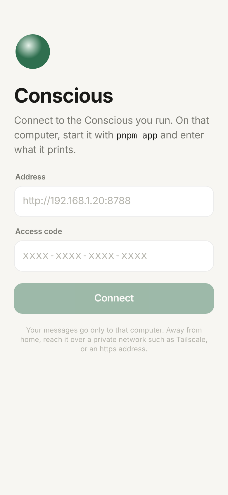
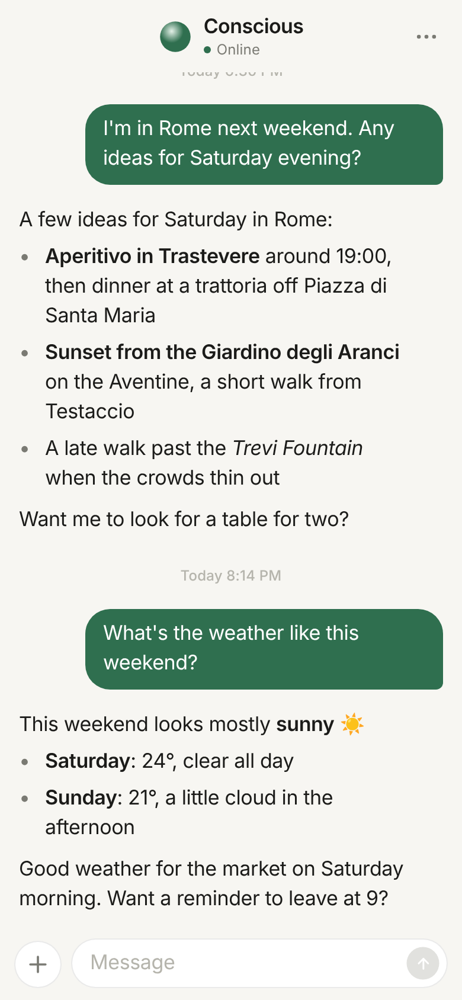
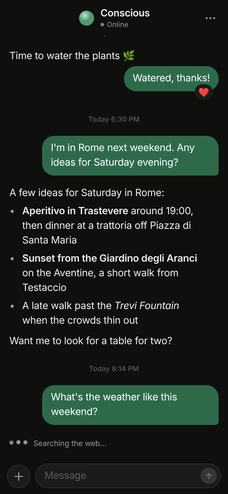

# Conscious for iPhone and Android

One chat with your Conscious. Answers are written out as they come, you see what it is doing while it works, it can react to your messages, photos go both ways, and reminders wait for you in the chat. Light and dark follow the phone.

<p>



</p>

It talks to the Conscious you run, over a WebSocket, and nothing else. There is no Conscious cloud in between.

## Run it

1. On the computer Conscious runs on: `pnpm app` in the repository root. It prints an address and an access code.
2. Here:

   ```bash
   cd mobile
   npm install
   npx expo start
   ```

3. Scan the QR code with [Expo Go](https://expo.dev/go) on a phone on the same Wi-Fi, and enter the address and code.

Everything the app uses ships in Expo Go, so no Xcode or Android Studio is needed to try it. For an app of your own on the home screen, build it with EAS: `npx eas-cli@latest build --profile preview`.

`npx expo start --web` opens it in a browser too, which is handy for working on the layout.

## How it is built

- Expo SDK 58, React Native, Expo Router (`src/app/`), Reanimated for motion, `react-native-svg` for the icons.
- `src/chat/useConscious.ts` holds the connection: it signs in with the code, reconnects with backoff (and at once when the app comes back to the front), keeps messages in an outbox until the socket is ready, and marks a message that may not have arrived so you can resend it.
- `src/protocol.ts` mirrors the server's message types in `src/channels/app.ts`. Change both together.
- `src/chat/Markdown.tsx` reads the Markdown the agent writes, including WhatsApp-style `*bold*`.
- The address and code are kept in the phone's secure storage.

## The Dot

Conscious's mascot is one dot. It has no face; its state shows in how it moves and in the soft trail it leaves, which fades as soon as the motion ends.

| State | When | Motion |
| --- | --- | --- |
| idle | Nothing going on | Drifts a little, then rests |
| thinking | Conscious is working | A calm, compact orbit |
| confirmed | An answer just arrived | One check-mark stroke, then rest |
| error | A failure, or the connection is down | Starts, stops short, steps back |
| awaiting | The last answer asked you something | Still, with a small loop now and then |

- `src/dot/motion.ts` is the motion engine. Each state is a moving target the dot follows on a spring, so a new state starts from wherever the dot is, never from a reset.
- `src/dot/Dot.tsx` draws the dot and its trail from the dot's recent path, on the UI thread. The trail is stacked faint layers, so it is strongest at the dot and fades along the path.
- `src/dot/useDotMood.ts` picks the state from the real chat state. It confirms only when an answer actually arrived.
- With Reduce Motion on, the dot stays still and a soft ring fades instead.
- Hold the dot in the chat header (or open `conscious:///dot`) to see every state at every size.
